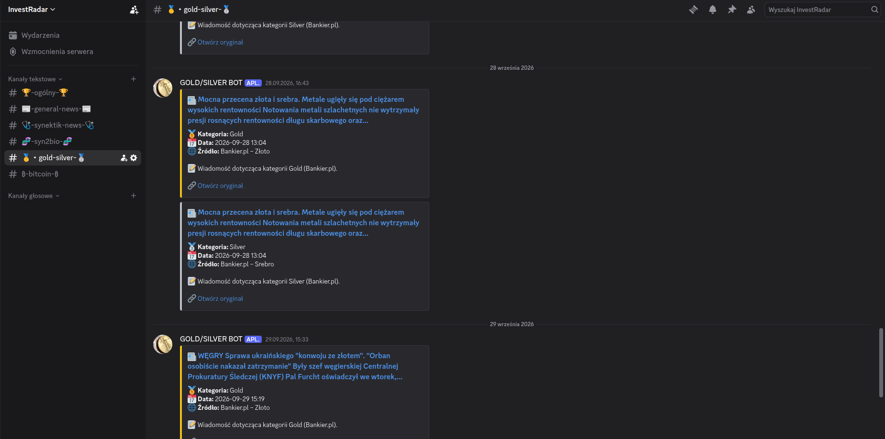
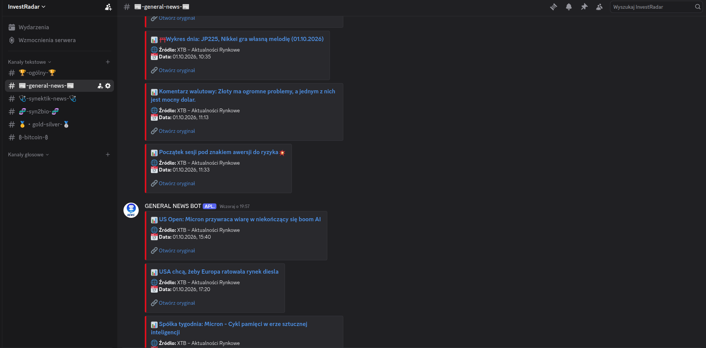

# Automated Market Radar


**Automated Market Radar** is a Python-based market monitoring project that collects selected financial news and market data, filters previously seen items, and sends new updates to Discord. GitHub Actions is used to automate scheduled runs and support manual execution.

The project is designed to reduce the need to manually check multiple financial news sources and company announcement pages.

## At a glance

- **News monitoring:** selected news from Bankier.pl, XTB Market News, and official company websites.
- **Tracked areas:** Bitcoin, gold and silver, Synektik, Syn2bio, and general market news.
- **Bitcoin price alerts:** stores the latest observed price, percentage change, and update timestamp.
- **Duplicate detection:** keeps previously seen article URLs or IDs in JSON state files.
- **Discord delivery:** posts updates with source information and links to the original articles.
- **Automation:** GitHub Actions supports scheduled and manual execution.

## Discord preview

The screenshots below show examples of the notifications posted by the project.

### Gold and silver news



### General market news



## What it monitors

| Area | Sources and data | Purpose |
|---|---|---|
| Bitcoin | Selected Bitcoin-related articles from Bankier.pl and saved price-alert state | Track relevant news and changes in the observed BTC price |
| Gold and silver | Selected precious-metals news from Bankier.pl | Collect news about precious metals in one Discord channel |
| Synektik | Company announcements and selected financial news | Follow company reports, announcements, and market coverage |
| Syn2bio | Company news and reports, plus selected Bankier.pl coverage | Keep relevant company updates together |
| General market news | XTB Market News | Receive selected broader market commentary and financial news |

The sources and previously seen items are represented in the repository's JSON state files. The collected news is informational; the project does not execute trades.

## How it works

```text
Configured sources
       │
       ▼
Python monitoring scripts
       │
       ├── Fetch market news and relevant data
       ├── Compare items with saved state to avoid duplicate notifications
       └── Prepare new notifications
       │
       ▼
Discord webhook notifications
       │
       ▼
JSON state files retain previously seen items and alert state

GitHub Actions runs the workflow on its configured schedule
and can also be used for manual execution.
```

This diagram summarizes the workflow at a high level. The exact sources, workflow settings, and implementation details are defined in the repository's scripts and workflow files.

## Repository structure

```text
04_Automated-Market-Radar/
├── .github/
│   └── workflows/          # GitHub Actions workflows
├── screens/                # Discord notification screenshots
├── scripts/                # Python monitoring scripts
├── bitcoin_state.json      # Seen Bitcoin news and BTC price-alert state
├── gold_silver_state.json  # Previously seen gold and silver news
├── syn2bio_state.json      # Previously seen Syn2bio news and reports
├── synektik_state.json     # Previously seen Synektik-related items
├── xtb_state.json          # Previously seen XTB news items
└── README.md
```

## State and duplicate detection

The JSON files at the repository root preserve information between runs. For example:

- `bitcoin_state.json` stores previously seen Bitcoin-related articles and a `price_alert` record containing the last observed price, percentage change, and update time.
- `gold_silver_state.json` stores previously seen articles about gold and silver.
- `syn2bio_state.json` stores previously seen company reports, company news, and related Bankier.pl articles.
- `synektik_state.json` stores previously seen Synektik-related announcements and news.
- `xtb_state.json` stores IDs or URLs of previously seen XTB news items.

This persistent state helps the system identify new items rather than repeatedly sending the same articles. The exact filtering and alert conditions are implemented in the Python scripts.

## Running the automation

The project uses GitHub Actions for automation.

1. Open the repository's **Actions** tab.
2. Select the relevant market monitoring workflow.
3. Use **Run workflow** when manual execution is available for that workflow.
4. Check the workflow run logs if a source or notification does not behave as expected.

For the exact schedule, runtime requirements, expected configuration, and secret names, consult the workflow YAML files and the Python scripts. Any Discord webhook URL or other credential should be stored securely as a GitHub Actions secret rather than committed to the repository.

## Technologies

- **Python** — monitoring and data-processing scripts.
- **REST APIs and web scraping** — collecting selected market information and news.
- **GitHub Actions** — scheduled and manual workflow execution.
- **Discord webhooks** — delivering notifications to Discord channels.
- **JSON** — persistent state for previously seen items and price-alert information.

## Project scope and limitations

- The project collects and forwards selected news and market data; it does not guarantee that every relevant market event will be detected.
- Source websites may change their layout, availability, or content, which can affect collection.
- Saved state represents what the scripts recorded during previous runs and is not a complete financial-news archive.
- BTC price-alert values depend on the data source and alert logic implemented in the scripts.
- Notifications are for monitoring and informational purposes only. They are **not investment advice**, and the project does not make or execute investment decisions.
